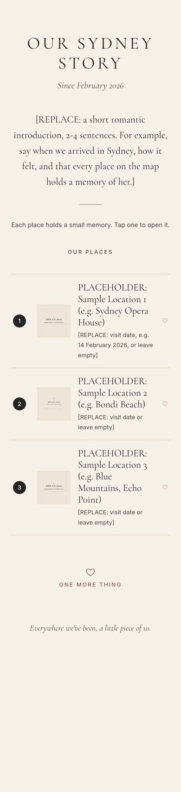
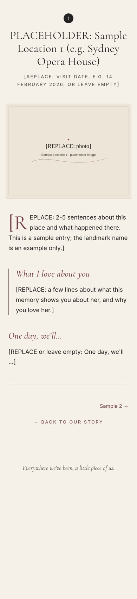
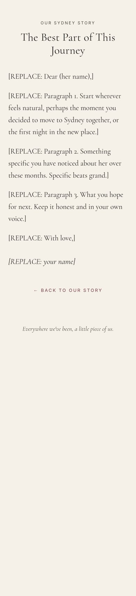
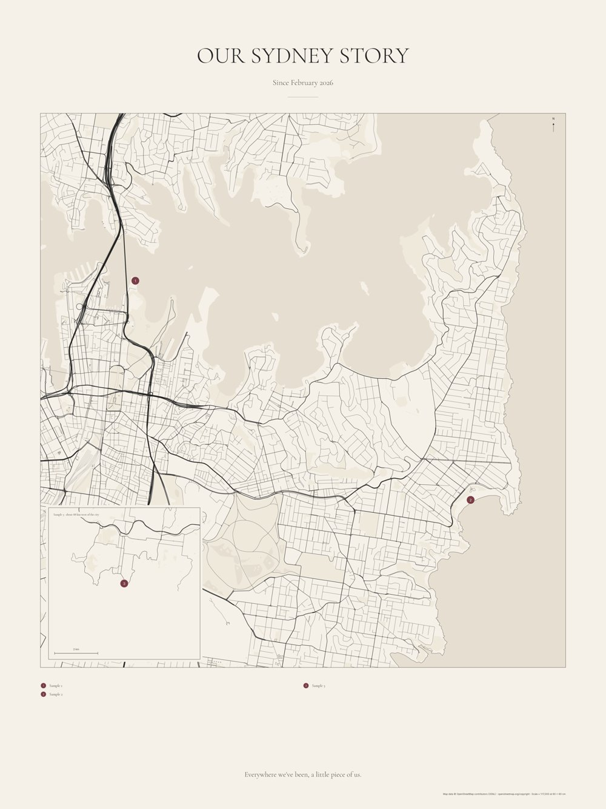

# Our Sydney Story: Build Guide

*A tap-to-remember map of Sydney: a physical canvas plus a small private-ish website, one page per place.*

Prepared 16 October 2026 for Gautam. Australian English. Everything marked **[REPLACE: …]** in the project is a placeholder for you to fill in. The three sample places are **fictional placeholders** that borrow public landmark names as examples only. No personal memories have been invented.

> **What has and hasn't been done.** The website, generator, link checker and map script were built and run on a test machine (details in §13). Nothing has been deployed, bought, or tested with real NFC hardware. Those steps are yours, and this guide walks you through each one.

---

## Contents

1. [Architecture and technical choices](#1-architecture-and-technical-choices)
2. [Project folder structure](#2-project-folder-structure)
3. [The website: editing, adding places, photos, writing](#3-the-website)
4. [Local preview and testing](#4-local-preview-and-testing)
5. [Publishing on GitHub Pages, step by step](#5-publishing-on-github-pages)
6. [The map: workflow, data and licensing](#6-the-map)
7. [NFC tags: choosing, writing, testing](#7-nfc-tags)
8. [The physical canvas and assembly](#8-the-physical-canvas-and-assembly)
9. [Privacy, hosting and reliability](#9-privacy-hosting-and-reliability)
10. [Budget (AUD)](#10-budget-aud)
11. [Implementation plan: 9 stages](#11-implementation-plan)
12. [Master checklist](#12-master-checklist)
13. [What was verified for this guide](#13-what-was-verified)
14. [What I still need from you](#14-what-i-need-from-you)

---

## 1. Architecture and technical choices

```
 data/locations.json ──► build.py ──► docs/ (static website) ──► GitHub Pages ──► https://…/memories/<slug>.html
        │                                                                              ▲
        └──────────► map/make_map.py ──► poster PDF/PNG + marker-positions.csv          │
                                              │                                         │
                                       printed canvas ── NFC sticker behind each dot ───┘  (tap = open URL)
```

| Decision | Choice | Why |
|---|---|---|
| Site type | Plain static HTML/CSS + a tiny bit of optional JS | No server, no database, nothing to break or pay for. Pages work with JavaScript turned off. |
| Content source | **One file**: `data/locations.json` | You edit words in one place; the generator writes every page. The map script reads the **same** file, so map numbers and pages always match. |
| Generator | `build.py`, Python 3 standard library only | No `npm install`, no frameworks. Runs on any Mac/Windows/Linux with Python 3.8+. |
| Hosting | GitHub Pages (free) | Free HTTPS, simple, and easy to move away from later. Alternatives in §9. |
| Published folder | `docs/` | GitHub Pages can publish straight from `/docs`, so the tools stay outside the website. |
| Links | **All relative** (`memories/x.html`, `../index.html`) | Works at `username.github.io/our-sydney-story/`, on a custom domain, or opened from disk. Verified under a simulated sub-path. |
| Fonts | Cormorant Garamond (headings) + Inter (body) via Google Fonts, with system fallbacks | Elegant and very legible. You can self-host them if you'd rather not load Google (see §9). |
| Map | Python + OpenStreetMap (osmnx/pyosmium, geopandas, matplotlib) | Geographically accurate, open licence, print-quality vector PDF. |
| NFC | NTAG213 25 mm round stickers holding one URL record | Reads on every NFC iPhone (XS and later) and NFC Android with no app. |

**URL pattern (permanent):** `https://<your-site>/memories/<slug>.html`. One tag per place. A cluster tag uses the same pattern: `memories/<cluster-slug>.html` (e.g. `memories/sydney-city.html`).

---

## 2. Project folder structure

```
our-sydney-story/
├── GUIDE.md / GUIDE.html / GUIDE.pdf   ← this guide
├── README.md                           ← quick start
├── build.py                            ← site generator (stdlib only)
├── nfc-urls.csv                        ← generated: exact URL for every tag + byte size check
├── data/
│   ├── locations.json                  ← THE file you edit (site text, places, letter, clusters)
│   └── slugs.lock.json                 ← created by `build.py --lock` after writing tags
├── templates/                          ← HTML templates (layout, home, memory, letter, cluster, 404)
├── tools/
│   ├── check_links.py                  ← link checker (disk or live server)
│   ├── make_placeholders.py            ← regenerates the cream SVG placeholder photos
│   └── prepare_photos.py               ← optional: resize + strip EXIF/GPS (needs Pillow)
├── docs/                               ← THE WEBSITE (this is what GitHub Pages publishes)
│   ├── index.html  our-story.html  404.html  robots.txt  .nojekyll
│   ├── memories/<slug>.html            ← generated, one per place
│   ├── memories/<cluster-slug>.html    ← cluster pages live here too (e.g. sydney-city)
│   ├── assets/css/style.css  assets/js/main.js  assets/img/…
│   └── media/photos/  media/audio/  media/video/
├── map/
│   ├── make_map.py                     ← print-ready poster generator
│   ├── get_osm_extract.sh              ← download OSM data once (avoids busy servers)
│   ├── requirements.txt  fonts/ (OFL licences included)
│   └── output/                         ← poster PDF/PNG, A1 proof, tag template, CSV, report
└── originals/                          ← your full-size photos (git-ignored, never published)
```

---

## 3. The website

### 3.1 How it works

1. Edit `data/locations.json`.
2. Run `python3 build.py`.
3. The `docs/` folder is regenerated: homepage list, every memory page, the letter page, the 404 page, and `nfc-urls.csv`.

The build **validates** your data first and stops with a clear message if something is wrong: a missing field, a duplicate number or slug, a photo file that doesn't exist, coordinates outside Sydney (often lat/lon swapped), or a locked slug that has gone missing. It also warns you how many `[REPLACE` placeholders are left. `python3 build.py --strict` refuses to build until none remain. Use it before the final publish.

### 3.2 Site settings (`"site"` in locations.json)

| Field | Meaning |
|---|---|
| `title`, `subtitle`, `footer` | "Our Sydney Story", "Since February 2026", "Everywhere we've been, a little piece of us." |
| `base_url` | The final address **ending in `/`**, e.g. `https://gautam-example.github.io/our-sydney-story/` or `https://oursydneystory.com.au/`. Used for `nfc-urls.csv` and the 404 page. |
| `intro` | The short romantic introduction on the homepage |
| `home_hint` | The small line under the intro |
| `letter.*` | Title, opening, body (blank line = new paragraph), closing, signature for `our-story.html` |
| `her_name`, `your_name` | For your own reference (not printed unless you add them to text) |

### 3.3 Adding the remaining 10–19 places

Copy one location block, paste it after the last one (mind the commas: JSON needs a comma **between** blocks, not after the last one), then change the fields:

| Field | Required | Notes |
|---|---|---|
| `number` | yes | The number printed on the map dot. Unique. Usually chronological. |
| `slug` | yes | URL name: lowercase, digits, hyphens: `manly-ferry`, `bondi-to-coogee`. **Permanent once tags are written.** |
| `name` | yes | Heading on the page, e.g. "Manly Wharf" |
| `short_name` | no | Shorter label for the map legend and prev/next links |
| `lat`, `lon` | yes | Decimal degrees. Sydney latitude is **negative** (≈ −33.8), longitude ≈ 151.2 |
| `date` | no | Free text ("14 February 2026", "Autumn 2026"); leave `""` to hide |
| `photo` | yes | Path inside `docs/`, e.g. `media/photos/manly-ferry.jpg` |
| `photo_small` | no | 800 px version for faster thumbnails and phones (`…-800.jpg`) |
| `photo_width`, `photo_height` | yes* | Pixel size of `photo`. Prevents the layout jumping while loading |
| `alt` | yes | What the photo shows, for screen readers ("Her laughing on the ferry deck, Opera House behind") |
| `story` | yes | The memory. Blank line = new paragraph |
| `love` | yes | "What I love about you" |
| `oneday` | no | "One day, we'll…"; leave `""` to hide the section |
| `audio` | no | e.g. `media/audio/manly.m4a` (AAC `.m4a` or `.mp3` play on iPhone and Android) |
| `video` / `video_poster` | no | e.g. `media/video/manly.mp4` (H.264 MP4, keep under ~20 MB) + a still image |
| `map_group` | no | `"main"`, `"inset"` (far away, e.g. Blue Mountains) or `"zoom"` (crowded CBD detail inset). Default: automatic |

**Finding coordinates:** in OpenStreetMap (openstreetmap.org), right-click the exact spot → *Show address* (or *Centre map here*), and the coordinates appear in the URL and sidebar. Google Maps also shows coordinates when you right-click; copying a *coordinate* is fine. Only screenshots of Google's map imagery are the problem. Use 4 decimal places (≈ 10 m). That is plenty for a 60 × 80 cm poster.

**Clusters (optional):** if several places are too close to get a tag each (see §8.4), add:

```json
"clusters": [
  { "slug": "circular-quay", "name": "Around Circular Quay", "members": ["opera-house", "the-rocks"],
    "intro": "A few memories within a short walk of each other." }
]
```

This creates `docs/memories/circular-quay.html` and adds a row to `nfc-urls.csv`.

> ### ⚠️ Never rename a slug after writing tags
> The tag stores the full URL. Rename `bondi` → `bondi-beach` and that tag opens a 404 for ever (or until you re-write it). Change the **name**, **story**, **photo** as often as you like; never the **slug**. After writing the tags, run `python3 build.py --lock`. From then on the build refuses to drop a locked slug.

The three samples use slugs like `sample-1-opera-house`. **Delete or rename the samples before you write any tags**, and before you run `--lock`.

### 3.4 Photos: resizing and removing location data

Phone photos carry EXIF metadata, often including **exact GPS coordinates** of where they were taken (which could be your home). Strip it before publishing.

- **Target:** JPEG, about **1600 px on the long edge**, quality ~75–82, **200–400 KB**. Also make an 800 px copy for `photo_small`.
- **Free tools that strip metadata:**
  - **Squoosh** (squoosh.app, by Google Chrome Labs): runs in your browser; images are not uploaded. Resize to 1600, MozJPEG quality ~75. The export does not keep EXIF.
  - **ImageOptim** (macOS, free): strips EXIF/GPS by default; resize first in Preview (*Tools → Adjust Size*).
  - **Windows:** right-click the file → *Properties → Details → Remove Properties and Personal Information → Create a copy with all possible properties removed*.
  - **iPhone, when sharing:** in the share sheet tap *Options* → turn off *Location*.
  - **Included script:** `python3 tools/prepare_photos.py originals/IMG_1234.jpg --slug manly-ferry` (needs `python3 -m pip install pillow`). It writes `docs/media/photos/manly-ferry.jpg` + `-800.jpg` with all metadata removed (tested: GPS tags present before, none after) and prints the JSON fields to paste.
- **HEIC (iPhone default):** convert to JPG first, e.g. on a Mac open in Preview → *File → Export → JPEG*, or set iPhone *Settings → Camera → Formats → Most Compatible* before taking new photos.
- Keep originals in `originals/` (git-ignored) **and** in a separate backup.
- Check the result: on a Mac, *Preview → Tools → Show Inspector* should show no GPS tab. On Windows, *Properties → Details* should show no GPS section.

### 3.5 Writing the pages

Short and specific beats long and general. Read each aloud once.

- **Story (2–5 sentences):** what you did, one sensory detail (the wind on the ferry, the chips you shared), one small moment.
- **What I love about you (2–4 lines):** link it to *this* memory: "the way you…" rather than generic praise.
- **One day, we'll… (optional, one line):** a promise or plan connected to the place.

### 3.6 The letter page (`our-story.html`): writing approaches

The page itself contains only placeholders. These are suggestions for you, not text for the page. Pick one approach and keep it in your own voice:

1. **The arc:** where you both were before Sydney → what this year has been like → what you hope comes next.
2. **Small things list:** five or six tiny, specific things you've noticed about her this year, each one sentence long.
3. **Letter to a future visit:** write it as if she's reading it a year from now, after you've added more places.
4. **Thank-you letter:** what she made easier, braver, or better since February.
5. **Answer a question:** "Why this map?" Explain why you made it and what the places add up to.

Tips: avoid clichés you wouldn't say out loud; one honest sentence is worth a paragraph of poetry. Don't publish anything you wouldn't want a stranger to read (see §9).

### 3.7 Accessibility and performance (built in)

- `lang="en-AU"`, skip-to-content link, visible focus outline, 44 px touch targets, semantic headings and `<nav>`.
- Colour contrast on cream (#F6F1E8): charcoal #242424 ≈ 13.8:1, secondary text #4A4744 ≈ 8.2:1, burgundy #783D46 ≈ 7.3:1 (all exceed WCAG AA; burgundy also passes AAA for body text).
- Every photo has `alt`, `width`/`height` (no layout jump) and `decoding="async"`. List thumbnails are `loading="lazy"`; the main photo on a memory page loads with `fetchpriority="high"`. Add `photo_small` and the build writes a `srcset` so phones download the 800 px version where it suffices.
- Audio/video use `preload="none"`, so nothing large downloads until she presses play.
- Animations respect `prefers-reduced-motion`.

---

## 4. Local preview and testing

```bash
cd our-sydney-story
python3 build.py                       # regenerate docs/
cd docs && python3 -m http.server 8000 # then open http://localhost:8000
```

Check links (in another terminal):

```bash
python3 tools/check_links.py                                   # files on disk
python3 tools/check_links.py http://localhost:8000/            # live crawl
```

**Simulate the GitHub sub-path** (this is how the site will really be served):

```bash
mkdir -p /tmp/ghp && ln -s "$PWD/docs" /tmp/ghp/our-sydney-story   # macOS/Linux
cd /tmp/ghp && python3 -m http.server 8001
python3 /path/to/our-sydney-story/tools/check_links.py http://localhost:8001/our-sydney-story/
```

(On Windows, copy `docs` into a folder named `our-sydney-story` inside an empty folder and serve that folder instead.)

Test on your phone: connect it to the same Wi-Fi and open `http://<your-computer's-IP>:8000`. Python's simple server does not show the custom 404 page; GitHub Pages does.

---

## 5. Publishing on GitHub Pages

1. Create a free account at github.com (pick a neutral username: it appears in the URL).
2. **New repository** → name `our-sydney-story` (or something less guessable, see §9) → **Public** (the free plan only publishes Pages from public repos) → *Create*.
3. Upload the project:
   - **Easiest:** on the repo page click *uploading an existing file* and drag in the **contents** of `our-sydney-story/` (not `originals/`, not `map/output/`, not `map/osm/`). Commit.
   - **Or with git:**
     ```bash
     cd our-sydney-story
     git init && git add . && git commit -m "Our Sydney Story"
     git branch -M main
     git remote add origin https://github.com/<username>/our-sydney-story.git
     git push -u origin main
     ```
     (`.gitignore` already excludes `originals/`, map outputs and caches.)
4. Repo → **Settings → Pages** → *Build and deployment* → Source **Deploy from a branch** → Branch **main**, folder **/docs** → *Save*.
5. Wait 1–2 minutes; the page shows "Your site is live at `https://<username>.github.io/our-sydney-story/`".
6. Put that address in `site.base_url`, run `python3 build.py` again, and commit/push. This updates `nfc-urls.csv` and the 404 page.
7. Test the live site: `python3 tools/check_links.py https://<username>.github.io/our-sydney-story/` and visit a made-up URL to see the 404 page.
8. **Updating later:** edit JSON → `python3 build.py` → commit/push (or upload the changed files). The tags do not change.

**Custom domain (strongly recommended before writing tags):** see §9.4.

---

## 6. The map

### 6.1 Data sources and licensing

| Source | Use it? | Terms in brief |
|---|---|---|
| **OpenStreetMap** (used by `make_map.py`) | ✅ Recommended | Open Database Licence (ODbL). Free for any use including print, **with attribution**: "© OpenStreetMap contributors". The poster prints this line. Keep it. See openstreetmap.org/copyright. |
| prettymaps (Python) | ✅ Alternative | Also draws OSM data. Same attribution. |
| Mapbox Studio / Static Images | ⚠️ Possible | Account required; free tier exists; print use has specific terms and requires "© Mapbox © OpenStreetMap" attribution. Check current terms before printing. |
| Stadia Maps (incl. Stamen styles) | ⚠️ Possible | Static/print use is tied to plan level; attribution required. Check current terms. |
| Felt | ⚠️ Possible | Easy web map maker with export; check the print/export terms on your plan. |
| Google Maps screenshots | ❌ Avoid | Google's terms restrict reuse of map imagery; print reproduction needs care and attribution and is easy to get wrong. Not needed when OSM is free and open. |

Fonts in `map/fonts/` are from Google Fonts under the SIL Open Font Licence (licence files included).

### 6.2 Workflow

1. **Collect places** in `data/locations.json` with accurate `lat`/`lon` (§3.3).
2. **Install** (once): Python 3.10+ then
   `python3 -m venv .venv && source .venv/bin/activate` (Windows: `.venv\Scripts\activate`)
   `pip install -r map/requirements.txt`
3. **Get data:** either let the script use the Overpass API (default, needs internet; public servers are often at capacity) **or** (most reliable) download once:
   `bash map/get_osm_extract.sh 150.25,-33.95,151.32,-33.66` (W,S,E,N covering all your places; needs `osmium-tool`). BBBike also offers a free ready-made "Sydney" extract (download.bbbike.org/osm/bbbike/Sydney/), but it only covers about 150.83–151.33 E, so it **excludes the Blue Mountains**.
4. **Render:**
   `python map/make_map.py --pbf map/osm/sydney-map.osm.pbf` (or just `python map/make_map.py` for Overpass)
5. **Review** `map/output/map-report.txt` and `preview-small.png`. Fix warnings (spacing, hidden markers).
6. **Tune** (all optional): `--pad 0.25` (more margin), `--min-width-km 12`, `--far-km 25`, `--dot-mm 9`, `--min-sep-mm 11`, `--line-scale 0.85`, `--no-parks`, `--bbox W,S,E,N` (force an exact extent), `--bleed-mm 40` (canvas wrap), `--width-mm 610 --height-mm 810` (match a printer's standard size).
7. **Proof** on paper (§6.6), then order.

### 6.3 What the script does

- **Projection:** GDA2020 / MGA zone 56 (EPSG:7856). Metres, true shape, correct for Sydney and the Blue Mountains.
- **Auto extent:** fits the main-map places plus padding, enforces a minimum width (9 km default) and expands to the frame's aspect ratio. The frame is 520 × 548 mm on a 600 × 800 mm canvas.
- **Roads weighted by class:** motorway 1.7 pt … residential 0.36 pt. Minor classes are dropped automatically when the map covers a wide area, so it never turns into a grey smudge. Rail is a faint dashed line.
- **Water:** sea and harbour are built from the OSM coastline (land is on the left of each coastline way), plus lakes and rivers. Parks are a barely-there tint.
- **Markers:** small burgundy numbered dots (8 mm). Overlapping dots are pushed apart, and a hairline leader goes back to a tiny dot at the true location.
- **Insets:** places more than 30 km from the group (e.g. Echo Point, Katoomba) go to a 150 × 150 mm **far inset** with a label such as "about 88 km west of the city" and its own scale bar. Crowded CBD places can go to a **zoom inset** (`"map_group": "zoom"`), and a dashed burgundy box shows where it sits. Insets are placed in whichever map corner covers the fewest markers.
- **Typography:** title, subtitle, numbered legend (2–3 columns), footer, scale bar, north arrow, and the required attribution with the real scale.

### 6.4 Outputs (`map/output/`)

| File | What it's for |
|---|---|
| `our-sydney-story-map.pdf` | Vector, exactly 600 × 800 mm. **Send this to the printer** if they accept PDF. |
| `our-sydney-story-map.png` | 7087 × 9449 px RGB at 300 dpi (flattened, no transparency) for printers that want an image. |
| `proof-A1-actual-size.pdf` | 1:1 paper proof on A1 (A1 is 594 mm wide, so 3 mm of plain margin is trimmed on each side) with a 100 mm check bar. |
| `tag-template-back.pdf` | Full-size **mirrored back view** with 25 mm circles where each tag goes, labelled with mm coordinates. |
| `marker-positions.csv` | Per marker: true and displayed position in **mm from the top-left of the front**, plus `back_x_mm`/`back_y_mm` (mirrored), nearest-neighbour distance and a spacing check. |
| `map-report.txt` | Extent, real-world scale, conversion formula and warnings. |

**Real-world scale (sample run):** the main map covered 9.00 × 9.48 km; **1 mm on canvas = 17.3 m** (1 cm ≈ 173 m, about 1:17,300). The far inset was 1 mm = 46.7 m. Your scale will change with your places. The report prints it every time.

**Lat/lon → canvas mm** (the script does this; the report shows your exact numbers):

```
(X, Y)    = project (lon, lat) from EPSG:4326 to EPSG:7856   (metres)
x_mm      = frame_x + (X − extent_minX) / metres_per_mm
y_mm      = frame_y + (extent_maxY − Y) / metres_per_mm
back_x_mm = canvas_width − x_mm        (mirror left↔right for the back)
back_y_mm = y_mm                       (top stays top)
```

### 6.5 Legibility at 60 × 80 cm

- Dots 8–9 mm, numbers ~10 pt. Legend text 10.5 pt and footer 20 pt are readable from about 1 m away.
- Keep at least 10 mm between dots on the front, and **≈ 35 mm between tags** on the back (see §8.4). The CSV flags anything closer.
- If the city part gets crowded, use a zoom inset or clusters instead of shrinking dots.
- Too busy? Use `--line-scale 0.8` or a larger `--min-width-km` (drops residential streets sooner). Too empty? Reduce `--pad`.

### 6.6 Printing notes: colour, resolution, proofing

- **Resolution:** 300 dpi PNG or vector PDF is more than enough. 150 dpi is fine for canvas texture.
- **CMYK safety:** the palette is muted and sits well inside a typical CMYK gamut, so expect only small shifts. Canvas inks and textures warm and soften colours slightly. Cream may print a touch yellower or greyer: ask the printer for a small test strip if colour matters to you. Most consumer canvas services want **RGB (sRGB)** files and convert to CMYK themselves. Don't convert yourself unless the printer asks and supplies an ICC profile. Officeworks' poster pages say they print in CMYK but also accept RGB.
- **Rich black:** the charcoal lines are #242424, which is not pure black, so fine lines stay crisp without colour fringing.
- **Canvas wrap/bleed:** a stretched canvas folds 3–4 cm around the edges. Either choose a "white/colour edge" wrap, or render with `--bleed-mm 40` and tell the printer the face is 600 × 800 mm. Our 40 mm margins keep all content off the fold. CSV coordinates are always relative to the finished **face**.
- **Paper proof (do this):** print `proof-A1-actual-size.pdf` at **actual size / 100 %** (Officeworks A1 colour poster, or A1 plan print in black and white; plan printing is limited to ≤15 % ink coverage, so a colour poster suits a map with large water areas). Check that the 100 mm bar measures 100 mm. Pin it up and view from 1–2 m. Then use it as your prototype for tag placement (§8.5).

---

## 7. NFC tags

### 7.1 Which tag

| Chip | User memory | Good for | Verdict |
|---|---|---|---|
| **NTAG213** | 144 bytes | One URL up to ~130 characters | ✅ **Use this.** Cheapest, universal. |
| NTAG215 | 504 bytes | Longer content (Amiibo etc.) | Unnecessary unless a URL won't fit |
| NTAG216 | 888 bytes | vCards, big records | Unnecessary |

`nfc-urls.csv` calculates the exact NDEF size of each URL and confirms it fits NTAG213 (the sample URLs are 52–89 bytes).

- **Size:** **25 mm round** (25–30 mm is ideal). Bigger antennas read more easily; avoid tiny 10 × 20 mm tags for this (reviews report patchy iPhone reads).
- **Paper or PET sticker**, not "on-metal"/ferrite tags (only needed if mounting on metal, which you shouldn't).
- **Quantity:** places + ~30 % spares. 15 places → 20 tags; 20 places → 26 tags. Include 2–3 extra for the prototype.

### 7.2 Writing a tag (NFC Tools by wakdev: free on iOS and Android)

1. Install **NFC Tools** (App Store / Google Play). On Android, turn NFC on in Settings.
2. Open `nfc-urls.csv` and copy the URL for tag #01.
3. NFC Tools → **Write** → **Add a record** → **URL / URI** → paste the full `https://…/memories/<slug>.html` → OK.
4. Tap **Write / Write (n bytes)** and hold the tag to the phone: near the **top edge on the back of an iPhone**, or the **centre of the back on most Androids**. Hold still until it confirms.
5. **Verify:** NFC Tools → **Read** → tap the tag → check the URL record is exactly right (no stray spaces, correct slug).
6. Real test: close the app, lock and unlock the phone, then tap the tag with the home screen showing. A notification/banner should appear; tap it and the page should open.
7. **Label** the tag's backing or paper liner with a pencil number (#01…) **before** you stick it. Keep a written log: tag number → slug → date written.

### 7.3 Lock or leave unlocked?

- **Recommended: leave unlocked.** You can re-write a tag if you ever change domain or fix a typo. Risk: someone with an NFC app could overwrite it. That is unlikely on a canvas hanging in your home.
- **Middle ground:** NFC Tools → *Other* → **Set password** protects the tag against writing (NTAG21x supports a 32-bit password). Store the password in your password manager.
- **Permanent lock** (*Other → Lock tag*) **cannot be undone**. Only do this if the URL is on a domain you will own for ever.

### 7.4 Phone behaviour you should know

- **iPhone XS/XR and later** read URL tags in the background with no app. The screen must be **on** and the phone **unlocked at least once since restart**. Background reading pauses while the camera, Wallet/Apple Pay or another NFC session is open, and in Airplane Mode. A banner appears; she taps it to open Safari. iPhone X and older (iPhone 7–X) need the NFC Tag Reader control in Control Centre.
- **iPhone antenna:** top edge on the back, near the cameras. **Android:** usually centre of the back (varies; some are near the camera).
- **Android:** NFC must be enabled (usually on by default). Screen on and unlocked; opens the browser directly or via a prompt.
- Thick phone cases with metal plates, MagSafe wallets or pop-sockets can block reads. Ask her to tap with the case off if one doesn't respond.
- Typical read distance through canvas is a few millimetres to ~2 cm. Prototype first (§8.5).

---

## 8. The physical canvas and assembly

### 8.1 Choosing the base

| Option | Pros | Cons | Verdict |
|---|---|---|---|
| **Stretched canvas** (gallery wrap) | Classic look, light, tags stick to the back of the fabric only ~0.5 mm from the front | Wooden stretcher bars hide parts of the back; fabric is soft (press gently) | ✅ Recommended. Avoid placing tags over bars. |
| Canvas board / panel | Flat and rigid, tags anywhere | Less "gallery" feel; 3–5 mm board between phone and tag (usually fine) | Good budget alternative |
| **Fine-art print in a frame**, mounted on foam board | Most refined; protected | Glazing + mount adds distance; metal frames and fittings interfere | ✅ Premium option: wooden frame, acrylic glazing, tags on the back of the print or mount, ≥3 cm from any metal |

### 8.2 Stretcher bars

Stretched canvases have 3–4 cm wide bars around the edge and often one or two **cross braces** at 60 × 80 cm. Before ordering, ask the printer: "Does a 60 × 80 cm canvas have a centre brace, and where?" Then:

- Keep markers out of the 45 mm border (the map frame already starts 40 mm in). Check that no marker falls on a brace line. If one does, nudge the dot with `--min-sep-mm`/`map_group`, or choose a brace-free/"floating" frame option.
- Tags on the back of the fabric; never under a bar.

### 8.3 Measuring and mirroring to the back

1. Lay the canvas **face down** on a clean towel.
2. Use `tag-template-back.pdf` (already mirrored) **or** measure from `marker-positions.csv`: `back_x_mm` from the **left** edge of the back (as you look at it) and `back_y_mm` from the **top**.
3. Measure from the **outer edge of the canvas face** (fold line), not the back edge of the bars. On a gallery wrap, put the ruler on the face edge where the fabric turns.
4. Mark each centre with a soft pencil cross on the back of the fabric. Double-check two or three against the front with a strong torch or by holding the canvas up to a window.

### 8.4 Spacing: when places are close

Tags closer than **~3–4 cm** centre to centre can be read together, or the phone picks the wrong one. Strategies, best first:

1. **Zoom inset** (`"map_group": "zoom"`): an enlarged CBD panel spreads the dots out, each with its own tag.
2. **Nudged marker with a leader line:** the script displaces dots and draws a hairline to the true spot. Increase `--min-sep-mm` towards 30–35 to spread them, if the design still looks good.
3. **One tag per cluster:** a single dot or ring marks the area, and the tag opens `memories/<cluster-slug>.html`, listing the 2–4 memories there.
4. Thinning: merge two very close places into one memory page.

Check `tag_spacing_ok` in the CSV; every row should say `yes`.

### 8.5 Prototype first (2–3 tags)

Before touching the real canvas:

1. Write 2–3 spare tags with real URLs.
2. Stick them behind the **A1 paper proof** (or a canvas offcut / cheap small canvas) at the CSV positions.
3. Test with her phone model if you can (or the same brand), plus yours: case on and off, from both portrait directions.
4. Try two tags 30 mm apart and 40 mm apart to see what your phones tolerate.

### 8.6 Adhesives and what to avoid

- Most NFC stickers are self-adhesive. For extra hold on canvas fabric, put a small square of **acid-free, photo-safe double-sided tape** on top, or cover each tag with an archival paper dot.
- ❌ No **foil-backed or metallic tape**, no metal staples or tacks near tags, no magnets, no aluminium frame hardware within ~3 cm. Metal detunes the antenna.
- If a tag must sit near metal, use **on-metal (ferrite-backed) tags**. You shouldn't need them here.
- Don't press hard on stretched canvas while sticking; support it from the front with a book wrapped in a clean cloth.
- Optional: add a small pencil number next to each tag and a printed "tag map" sheet taped inside the back for future repairs.

### 8.7 Final testing

For every marker: phone locked → unlock → tap the front dot → correct page opens. Tick it on a printed list. Test with iPhone and Android if possible, and repeat after hanging (wall brackets and wires can be metal: keep them away from tags).

---

## 9. Privacy, hosting and reliability

### 9.1 What "public" means here

- On GitHub's free plan, **Pages sites are published from public repositories**, so **both the site and the repository (including `locations.json`, your words and the photos) are visible to anyone.** Paid plans can publish from a private repo, **but the Pages site itself is still public on the internet** (private-visibility Pages is an Enterprise Cloud feature).
- `noindex` meta tags and `robots.txt` (both included) ask search engines not to list the pages. **This does not make the site private.** Anyone with a URL can open it, and URLs can leak (shared screenshots, browser sync, a guest tapping a tag).
- GitHub logs visitor IP addresses for security (GitHub's docs), and Google Fonts receives the visitor's IP when loading fonts. To avoid Google, download the two font families and serve them from `docs/assets/fonts/` with `@font-face`.

### 9.2 Keep sensitive things off the site

- No home address, suburb-level home locations, workplace, surnames, phone numbers, birthdays, travel dates you're away, or anything you'd regret on a billboard.
- Strip EXIF/GPS from every photo (§3.4). Check photos for visible street numbers, mail, boarding passes and screens.
- Use first names or nicknames.
- Remember the repo history keeps old versions. If you ever publish something sensitive, delete the repository and create a fresh one rather than just deleting the file.

### 9.3 More private options

| Option | Privacy | Effort / cost | Caveats |
|---|---|---|---|
| **Unlisted URL** (what this project does by default) | Low: obscurity only | Free | Use a non-obvious repo name (`os-story-7k2q`) and slugs that don't reveal places if you like (`m01-x7`, but keep them permanent!) |
| **StatiCrypt** (encrypts each HTML page with a password) | Medium: content encrypted | Free, open source | Images, audio and video are **not** encrypted unless you embed or handle them separately; she'd type a password (can be remembered on her device); a weak password can be brute-forced offline; NFC tap → password page adds friction |
| **Cloudflare Pages + Cloudflare Access** (Zero Trust free plan: up to 50 users) | High: real login (email one-time code) before anything loads | Free; ~30–60 min setup; needs a Cloudflare account (a custom domain is optional) | She logs in once per session/device; if the login expires, a tap shows a login page first |
| **Netlify/Vercel with password** | High | Usually paid tiers | Not needed if Cloudflare works for you |

Recommendation: start public-but-unlisted with care about content. If you want real privacy, use **Cloudflare Pages + Access** (the `docs/` folder deploys as-is: build command none, output directory `docs`).

### 9.4 Reliability: make the tags outlive the host

**An NFC tag only works while its URL keeps working.** If GitHub changes, your username changes, or you move hosts, `username.github.io/...` tags break.

- **Strongly recommended:** buy a domain you control (e.g. `oursydneystory.com.au` or `.au`) and write **that** domain on the tags: `https://oursydneystory.com.au/memories/<slug>.html`. Point it at GitHub Pages today (repo Settings → Pages → *Custom domain*, then add the DNS records GitHub shows; tick *Enforce HTTPS*). Move to any other host later without touching the tags.
- Note: `.au` domains need an Australian presence (residents/visa holders usually qualify; check auDA eligibility). Cloudflare Registrar does **not** sell `.au` (as of 16 Oct 2026); use an Australian registrar such as VentraIP, then optionally use Cloudflare DNS.
- **Set the domain's auto-renew and a calendar reminder.** A lapsed domain breaks every tag.
- **Backups:** keep the whole project folder (including `originals/`) in two places, e.g. external drive + cloud. GitHub is not a backup of your originals.
- **If the host disappears:** the site is plain files. Upload `docs/` to Cloudflare Pages, Netlify, or any web host, and point the domain there. The tags keep working. Without a custom domain you'd have to re-write every tag (possible if unlocked).
- **Migration checklist:** same folder structure, same slugs, `.html` extensions kept, `base_url` updated, run the link checker against the new host.

---

## 10. Budget (AUD)

Prices were checked online on **16 October 2026** unless marked *Estimate*. Prices change; delivery is extra unless stated. "Verified" means I saw the price on the linked page that day (or, where noted, on a recent third-party price index).

### 10.1 Verified prices

| Item | Supplier | Price | Status / source |
|---|---|---|---|
| NTAG213 25 mm adhesive tag (single) | Core Electronics (CE08499) | **$1.55 each** inc GST; shipping from $7 | Verified: https://core-electronics.com.au/rfidnfc-tag-adhesive-ntag213-chip-1356mhz.html (32 in stock). The 5-pack (CE08510) is retired. |
| 10× NTAG213 25 mm stickers | eBay AU (seller "howmuchisittoday", Melbourne) | **$5.95 per 10**, free untracked post | Verified: https://www.ebay.com.au/itm/122695598800 |
| 20× NTAG213 25 mm round stickers (Fongwah) | Amazon AU | **$25.60** | Verified: https://www.amazon.com.au/dp/B071XCFMHN |
| 50× NTAG213 10 × 20 mm stickers (Rhoyee) | Amazon AU | $12.99 | Verified, **not recommended** (tiny antenna, mixed reviews): https://www.amazon.com.au/dp/B0FFZ2TDLL |
| Canvas 24 × 30" (61 × 76 cm) | Officeworks Photos | **$130** | Verified: https://www.officeworksphotos.com.au/collections/rectangle-canvas-prints (no 60 × 80; 24 × 36" is $165). Re-render with `--width-mm 610 --height-mm 762`. |
| Canvas 61 × 81 cm (24 × 32") stretched | Canvas Prints Australia (Noosa/Perth) | **$205** (delivery at checkout) | Verified: https://www.canvasprintsaustralia.net.au/size-and-price-guide/ |
| Framed fine-art print 61 × 81 cm (300 gsm paper, 30 mm timber, Perspex) | Canvas Prints Australia | **$213** | Same page |
| Floating-frame canvas 61 × 81 cm | Canvas Prints Australia | **$529** | Same page |
| Rolled canvas 61 × 81 cm (for local framer) | Canvas Prints Australia | $149 | Same page |
| Paper lustre print 61 × 81 cm | Canvas Prints Australia | $95 | Same page |
| Canvas 60 × 80 cm (24 × 32") | Custom Canvas Online | **$92.26** "now" (shipping at checkout) | Verified: https://www.customcanvasonline.com.au/24x32-canvas-print/. Shown against a "MSRP $615" anchor price; check reviews and turnaround before relying on it. |
| A1 foam board 5 mm white | Officeworks | **$12.00** | Verified: https://www.officeworks.com.au/shop/officeworks/p/a1-foam-board-5mm-white-ljpcfba1we |
| Double-sided tape 12 mm × 6 m (J.Burrows) | Officeworks | **$3.75** | Price verified: https://www.officeworks.com.au/shop/officeworks/p/j-burrows-double-sided-tape-12mm-x-6m-jbdbtpe126. Acid-free/photo-safe claim seen only in search summary: check the pack. |
| Frame 61 × 91 cm (RÖDALM, black) | IKEA AU | **$39.99** | Verified: https://www.ikea.com/au/en/p/roedalm-frame-black-90550111/. Fits 61 × 91 or 50 × 70 with mount; **not** 60 × 80 without a custom mat. |
| Colour poster printing (A4–B0) | Officeworks | **from $7.50**; premium posters from $18; plans from $3.50 (≤15 % coverage) | Verified "from" prices only: https://www.officeworks.com.au/print-copy/p/colour-posters-pcppcopcp, …/premium-posters-pcppprpcp, https://api.officeworks.com.au/print-copy/p/plans-pcppplcp. The A1 price wasn't shown without the configurator. |
| `.com.au` / `.au` domain | VentraIP | **$9.95 first year, $22.95/yr renewal** | VentraIP homepage shows "$9.95/yr* was $22.95/yr" (https://ventraip.com.au/); TLD confirmed by Pick a Host's index (checked 27 Sep 2026): https://pickahost.com.au/australian-web-hosting-price-index/ |
| Cloudflare Registrar `.au` | Cloudflare | Not available | Verified: `.au` not in https://www.cloudflare.com/en-au/tld-policies/ |
| GitHub Pages hosting | GitHub | $0 | Free for public repositories |
| Cloudflare Pages + Access (≤50 users) | Cloudflare | $0 | Free plan per Cloudflare Zero Trust plans page (via search summary): https://www.cloudflare.com/plans/zero-trust-services/ |

### 10.2 Estimates (not verified)

| Item | Estimate |
|---|---|
| Officeworks A1 colour poster (proof) | $15–30 *Estimate* |
| `.com` domain (Cloudflare at-cost or VentraIP) | $16–25/yr *Estimate* |
| Canvas/print delivery to Sydney | $15–35 *Estimate* |
| Steel ruler 60 cm, soft pencil, craft knife, cutting mat (if you have none) | $15–30 *Estimate* |
| Custom picture framing 60 × 80 cm at a Sydney framer (timber, acrylic, acid-free backing) | $180–350 *Estimate* |
| Gift wrap / tube / ribbon | $10–20 *Estimate* |

### 10.3 Three builds

**A. Budget DIY: ≈ $170–215** (incl. a few tools/delivery)

| Item | Cost |
|---|---|
| Officeworks Photos 61 × 76 cm canvas (render at 610 × 762) | $130 (V) |
| 30 tags: 3 × eBay 10-packs | $17.85 (V) |
| Double-sided tape | $3.75 (V) |
| A1 paper proof | $15–30 (E) |
| Domain | $0 (github.io), *but see §9.4* |
| Hosting | $0 |
| **Total** | **≈ $167–182 + any tools/delivery** |

**B. Recommended: ≈ $275–330**

| Item | Cost |
|---|---|
| Canvas Prints Australia 61 × 81 cm stretched canvas (render at 610 × 810) | $205 (V) + delivery $15–35 (E) |
| 20 Fongwah 25 mm NTAG213 (Amazon AU) **or** 20 × Core Electronics singles ($31 + $7 post) | $25.60–38 (V) |
| Double-sided tape | $3.75 (V) |
| A1 paper proof (doubles as tag prototype) | $15–30 (E) |
| `.com.au` domain, first year | $9.95 (V) |
| Hosting | $0 |
| **Total** | **≈ $275–330** |

**C. Premium finish: ≈ $630–675** (or ≈ $315–360 with the framed-print option)

| Item | Cost |
|---|---|
| Canvas Prints Australia floating-frame canvas 61 × 81 cm | $529 (V) |
| *Alternative:* framed fine-art print 61 × 81 cm | $213 (V) |
| 25–30 tags (Core Electronics singles, local AU stock) | $39–47 + $7 post (V) |
| A1 foam board for prototype/backing | $12 (V) |
| Double-sided tape | $3.75 (V) |
| A1 colour proof | $15–30 (E) |
| `.com.au` domain | $9.95 first year (V) |
| Delivery | $15–35 (E) |
| **Total** | **≈ $630–675** (floating frame) / **≈ $315–360** (framed print) |

Skip: NFC writers or readers (your phone does it), on-metal tags, paid hosting, website builders, NTAG215/216.

---

## 11. Implementation plan

### Stage 1: Collect locations, photos and memories
- **Tasks:** list every place since Feb 2026 (scroll Photos by month; check Maps timeline if enabled); pick one photo per place; note dates; write rough notes for story / love / one-day; get coordinates; decide numbering (chronological is lovely).
- **Tools:** phone Photos, OpenStreetMap, a notes app or the JSON file.
- **Time:** 3–6 hours over a few evenings.
- **Common mistakes:** too many places (stick to 11–20); swapped lat/lon; choosing photos with private details; asking her questions that give the surprise away.
- **Done when:** ☐ final list with numbers ☐ one photo each ☐ coordinates for all ☐ draft notes for all

### Stage 2: Set up the website and homepage
- **Tasks:** install Python 3; unzip the project; run `python3 build.py`; preview locally; replace site title/intro; delete the three sample places.
- **Tools:** Python 3, text editor (VS Code is free), browser.
- **Time:** 1–2 hours.
- **Common mistakes:** breaking JSON with a missing comma or quote (the build tells you the line); editing generated HTML in `docs/` instead of the JSON (it gets overwritten).
- **Done when:** ☐ build runs ☐ homepage shows your intro ☐ samples removed

### Stage 3: Build and populate memory pages
- **Tasks:** prepare photos (§3.4); add each place to the JSON; write story / love / one-day; optional audio/video; write the letter.
- **Time:** 4–8 hours (writing takes the longest).
- **Common mistakes:** 5 MB photos; leftover GPS EXIF; inconsistent names vs map; forgetting `alt` text.
- **Done when:** ☐ every place has a real photo ≤ 400 KB ☐ no `[REPLACE` left (`python3 build.py --strict` passes) ☐ letter written

### Stage 4: Test links and deploy
- **Tasks:** run the link checker; test on your phone over Wi-Fi; decide domain (§9.4); publish to GitHub Pages (§5); set `base_url`; rebuild and push; run the link checker against the live URL.
- **Time:** 1–2 hours (+ DNS wait if using a domain, usually under an hour, sometimes up to 24 h).
- **Common mistakes:** publishing from the root instead of `/docs`; `base_url` without the trailing `/`; private repo on the free plan (Pages won't publish); not enabling HTTPS.
- **Done when:** ☐ live site loads on mobile data (not just Wi-Fi) ☐ live link check passes ☐ `nfc-urls.csv` shows final URLs

### Stage 5: Design the map and produce the print file
- **Tasks:** install map requirements; get OSM data; run `make_map.py` at the printer's exact size; fix spacing warnings (zoom inset / clusters); check spelling in the legend; print the A1 proof; view from 1–2 m; adjust; final render.
- **Time:** 2–4 hours + proof turnaround.
- **Common mistakes:** ordering a size that doesn't match the render (stretching distorts geography); ignoring cross braces; removing the OSM attribution; markers on the canvas wrap edge.
- **Done when:** ☐ `map-report.txt` has no warnings ☐ proof approved ☐ final PDF/PNG at the ordered size ☐ canvas ordered (allow 1–2 weeks)

### Stage 6: Buy sample tags and build a prototype
- **Tasks:** order tags (+30 % spares); write 2–3 with real URLs; stick behind the A1 proof at CSV positions; test iPhone/Android, case on/off, 30 vs 40 mm spacing.
- **Time:** 1 hour (+ delivery).
- **Common mistakes:** testing with the app open (test from the home screen); using 10 × 20 mm tags; testing only your phone.
- **Done when:** ☐ reliable single-tap reads on her phone type ☐ spacing rule confirmed

### Stage 7: Programme all tags and attach them
- **Tasks:** write each tag from `nfc-urls.csv`; read back to verify; pencil-label; run `python3 build.py --lock`; mark positions on the back using the template/CSV; attach with gentle pressure; optional acid-free tape cover.
- **Time:** 1.5–3 hours.
- **Common mistakes:** mirror mistake (left/right swapped on the back); writing tag #7's URL onto #8; locking tags; placing over a stretcher bar or brace; pressing hard on the canvas.
- **Done when:** ☐ every tag read-back verified ☐ slugs locked ☐ every tag attached at its measured spot

### Stage 8: Test every marker and finish
- **Tasks:** test every dot from the front (phone locked → unlocked → tap); fix any misses (re-position or re-write a spare); add a discreet "tap the dots" hint card if you like; label the back with the domain and renewal date.
- **Time:** 1 hour.
- **Common mistakes:** testing only on Wi-Fi; hanging hardware near tags.
- **Done when:** ☐ 100 % of markers open the right page on iPhone and Android ☐ back labelled

### Stage 9: Prepare the gift and reveal
- **Tasks:** wrap; plan the moment (hang it first, or hand it over with "try tapping number 1 with your phone"); make sure her phone's NFC works (Android: NFC on); keep the letter page as the finale (the heart link at the bottom of the homepage).
- **Time:** 30 min.
- **Common mistakes:** revealing with a flat phone battery or Airplane Mode on; a site cached in a half-updated state (do a final check the morning of).
- **Done when:** ☐ final check that morning ☐ gift wrapped ☐ phone charged

---

## 12. Master checklist

**Content**
- ☐ 11–20 places listed, numbered, with coordinates
- ☐ One stripped, resized photo per place (≤ 400 KB, no GPS)
- ☐ Story, "What I love about you", optional "One day, we'll…" for each
- ☐ Letter written
- ☐ Samples deleted; `python3 build.py --strict` passes

**Website**
- ☐ Local preview checked on a phone
- ☐ Link checker passes on disk, under a sub-path, and live
- ☐ Domain decided (custom domain recommended) and `base_url` set
- ☐ GitHub Pages live from `/docs`, HTTPS on
- ☐ Nothing sensitive in the repo or photos

**Map and print**
- ☐ Rendered at the exact ordered size; legend spelling checked
- ☐ No spacing or hidden-marker warnings in `map-report.txt`
- ☐ OSM attribution visible
- ☐ A1 proof printed at 100 % and approved
- ☐ Printer asked about stretcher braces and wrap
- ☐ Canvas ordered

**NFC**
- ☐ Tags: NTAG213, 25 mm, places + 30 %
- ☐ Prototype passed on iPhone and Android
- ☐ Every tag written from `nfc-urls.csv`, read back, labelled
- ☐ `python3 build.py --lock` run
- ☐ Tags placed using `back_x_mm`/`back_y_mm` (mirrored!), clear of bars and metal
- ☐ Every marker tested from the front

**Long-term**
- ☐ Project + originals backed up in two places
- ☐ Domain auto-renew on + calendar reminder
- ☐ Tag passwords (if any) saved

---

## 13. What was verified

On the build machine (16 Oct 2026, Sydney time):

- `python3 build.py` generated 6 pages (homepage, 3 sample memory pages, letter, 404) plus `nfc-urls.csv`.
- `tools/check_links.py` passed **on disk** (53 references) and in an **HTTP crawl under a simulated GitHub sub-path** (`/our-sydney-story/`, 13 URLs incl. 404 page): no broken or root-absolute links. The checker also confirmed that serving `docs/` at the domain root works for all pages except the 404 page (expected: it uses the `base_url` path, as GitHub Pages needs).
- Generator safeguards tested: cluster page generation, `--lock`, refusal to build when a locked slug was renamed, `--strict` failing with placeholders present.
- `tools/prepare_photos.py`: a test JPEG with GPS EXIF came out with no EXIF/GPS.
- Mobile screenshots (390 px wide, headless Chrome) of the homepage, a memory page and the letter page.
- `map/make_map.py` ran on the 3 sample points with **real OpenStreetMap data** from a Geofabrik Australia extract (downloaded 16 Oct 2026, cut with osmium to Sydney + Blue Mountains). It produced the 600 × 800 mm PDF, a 7087 × 9449 px 300 dpi RGB PNG, the A1 proof, the mirrored tag template, the CSV and the report. Collision handling and the zoom inset were tested with extra synthetic CBD points. A 610 × 810 mm render was also tested.
- **Not working at build time:** the public **Overpass API** (default data source) returned "server at capacity"/SSL errors from all servers tried, so the Overpass code path was **not** exercised end to end. The `--pbf` path is what produced the sample map. Retry Overpass later, or use `get_osm_extract.sh`.
- **Not done:** deployment, purchasing, NFC writing or reading, physical printing.

**Previews (placeholder content):**

| Homepage | Memory page | Letter page |
|---|---|---|
|  |  |  |



---

## 14. What I need from you

1. **The list of places** (11–20): name as you'd like it shown, rough date, and the exact spot (a pin link or coordinates).
2. **Numbering order:** chronological, or your choice.
3. **One photo per place** (original files are fine; I can show you how to resize/strip them) + one-line alt descriptions.
4. **Your words** for each place: story, "What I love about you", optional "One day, we'll…" (rough notes are fine).
5. **Her name or nickname** as it should appear (or none), and how you sign off.
6. **The letter** (or bullet points to shape into a draft you then make your own).
7. **Hosting decision:** github.io address or a custom domain (and which name, e.g. `oursydneystory.com.au`), and whether you want a login (Cloudflare Access) or are fine with unlisted.
8. **Your GitHub username** (or the domain), to fill `base_url`.
9. **Canvas choice:** which printer and exact size, so the map renders at that size; whether it has a centre brace.
10. **Her phone model** (iPhone/Android, model), for prototype testing advice.
11. Any **audio or video** you want on particular pages.
12. Anything that must **not** appear publicly.
